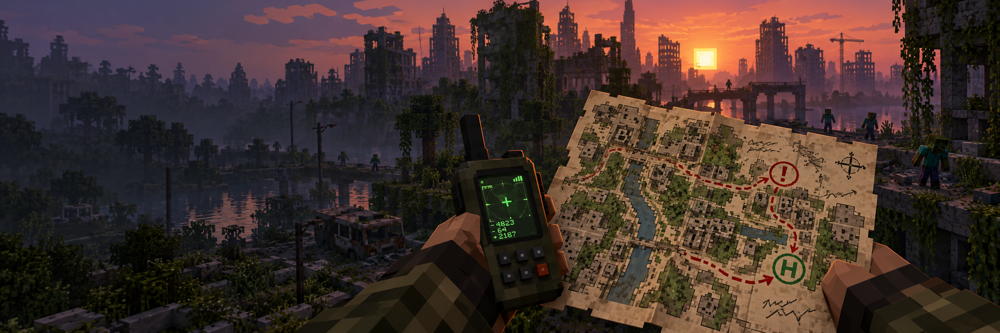

<p align="center">
  
</p>

<p align="center">
  
  
  
  
</p>

# Lazarus Maps

**Lazarus Maps** é um mod para Minecraft Forge 1.20.1 criado para o modpack **Project Lazarus**. Ele transforma o mapa comum do Minecraft num mapa de campo do sobrevivente: dá para riscar rotas, escrever notas e marcar perigos e abrigos por cima do desenho do terreno. Ele também acrescenta um **receptor GPS** que mostra as coordenadas na tela.

As anotações ficam visíveis no próprio mapa quando ele está na mão. O desenho original do mapa nunca é alterado.

> Os textos dentro do jogo estão em inglês e em português, conforme o idioma do jogo.

---

## Sumário

- [Mapa anotado](#mapa-anotado)
- [Ferramentas do editor](#ferramentas-do-editor)
- [Mapas compartilhados](#mapas-compartilhados)
- [Receptor GPS](#receptor-gps)
- [Instalação](#instalação)
- [Limites atuais](#limites-atuais)
- [Créditos e licença](#créditos-e-licença)

---

## Mapa anotado

Clique com o botão direito num **mapa preenchido** para abrir o editor. Ele mostra o desenho do terreno em tamanho grande e o seu **marcador de posição**, como no mapa na mão.

Tudo o que você desenha aparece também no mapa **segurado em qualquer uma das mãos**, nas mesmas posições do editor. Ao segurar um mapa, o jogo busca as anotações dele sozinho, sem precisar abrir o editor.

---

## Ferramentas do editor

| Ferramenta | Uso |
|---|---|
| **Caneta** | Arraste para desenhar traços e rotas. |
| **Nota** | Clique no mapa, escreva até 48 caracteres e salve. |
| **Perigo** | Clique para marcar um ponto de perigo, um quadrado vermelho com **!**. |
| **Abrigo** | Clique para marcar um abrigo, um quadrado verde com **H**. |
| **Mover** | Clique num elemento e arraste para outro lugar; ele para nas bordas do mapa. |
| **Pintar** | Escolha uma cor e clique num traço ou numa nota para recolorir. |
| **Apagar** | Clique num elemento para apagar. O botão direito apaga com qualquer ferramenta. |

A **paleta** abaixo das ferramentas tem oito cores para traços e notas: tinta, vermelho, azul, verde, amarelo, laranja, roxo e branco. Perigo e abrigo mantêm vermelho e verde, para o significado ficar claro em qualquer mapa.

---

## Mapas compartilhados

- As anotações são salvas no mundo, pelo número do mapa do Minecraft. **Cópias do mesmo mapa** compartilham as anotações.
- Qualquer jogador **segurando** o mapa pode editá-lo. As mudanças chegam na hora a todos que estão com ele na mão.
- Os dados ficam em `data/lazarusmaps_notes.dat`, dentro da pasta do mundo. Remover o mod não altera os mapas do Minecraft.

---

## Receptor GPS

Segure o **receptor GPS** em qualquer mão para ver **X, Y, Z** e a dimensão atual num pequeno quadro no canto da tela.

Receita (bancada):

| | | |
|:---:|:---:|:---:|
| Barra de ferro | Redstone | Barra de ferro |
| Redstone | Bússola | Redstone |
| Barra de ferro | Barra de ouro | Barra de ferro |

As coordenadas do F3 continuam disponíveis normalmente.

---

## Instalação

### Requisitos

- **Minecraft 1.20.1**
- **Minecraft Forge 47.x** (desenvolvido com 47.4.10)
- **Java 17**

### Jogadores e servidores

1. Baixe [`lazarusmaps-0.3.0.jar`](dist/lazarusmaps-0.3.0.jar).
2. Coloque o JAR na pasta `mods` do perfil. No CurseForge, clique com o botão direito no perfil e escolha **Open Folder**.
3. Em multiplayer, instale a mesma versão no servidor e em todos os clientes.
4. Remova qualquer JAR antigo `lazarusmaps` antes de atualizar e reinicie o Minecraft.

> Para testar, use um mapa preenchido de verdade: faça um mapa vazio e use-o. Um `filled_map` criado por comando pode vir sem dados de mapa.

### Compilar a partir do código

Com JDK 17 instalado, execute na raiz do projeto:

```bash
gradlew build
```

O JAR compilado fica em `build/libs/`.

---

## Limites atuais

- Cada mapa guarda até **256** anotações, e um traço guarda até **256** pontos.
- As anotações ainda não aparecem em **mapas dentro de molduras**.
- Mapas ampliados ou recriados ganham um número novo no Minecraft e não herdam as anotações.
- Ainda não há desfazer/refazer nem controle de quem pode editar cada mapa.
- O GPS ainda não usa bateria e funciona em qualquer lugar.

---

## Créditos e licença

- Desenvolvido para o **Project Lazarus**.
- Usa o mapa e o desenho de mapas do próprio Minecraft; as anotações são desenhadas por cima.
- Banner: arte gerada com IA para o Lazarus Maps.
- Não é afiliado à Mojang ou à Microsoft.

**Licença:** All Rights Reserved.
